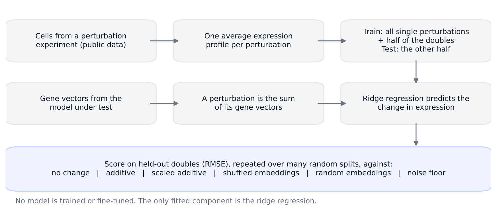
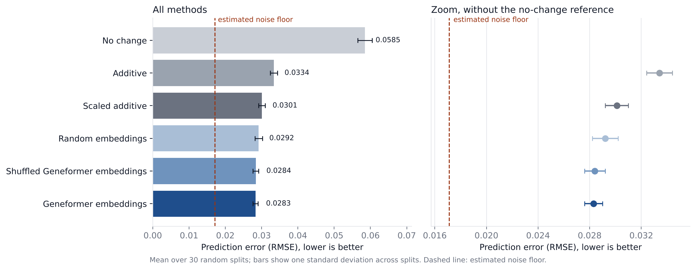
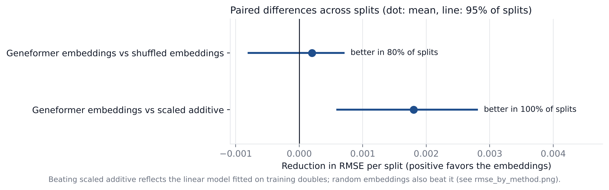
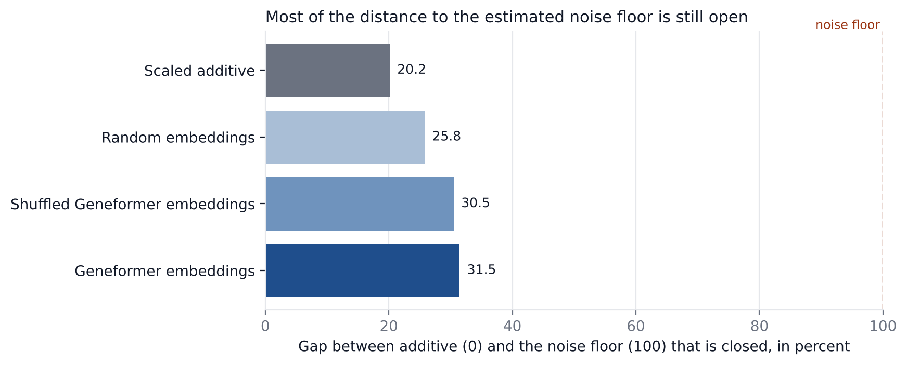

# CellCheck

An open benchmark that tests whether a model's gene embeddings predict what happens to a cell when genes are perturbed,
better than simple rules and better than controls that carry no gene information.



## Why this exists

Drug discovery teams need to know what a cell will do when a gene is turned up or down. Lab experiments are slow and
expensive, so pretrained single-cell models are increasingly used to predict the answer. Independent studies report that
such models often do no better than very simple methods, for example
[Ahlmann-Eltze et al., Nature Methods 2025](https://doi.org/10.1038/s41592-025-02772-6) and
[PertEval-scFM, ICML 2025](https://icml.cc/virtual/2025/poster/43799).

If a team trusts a model that is not actually better, it can spend months on a wrong target. CellCheck gives a small,
repeatable way to check a model before trusting it. It runs on one T4 GPU, and the main benchmark runs on a CPU.

## Result at a glance

Task: predict the expression change of 62 held-out double perturbations (Norman et al. 2019), repeated over 30 random
splits. Model tested: NVIDIA BioNeMo's Geneformer V2-104M, using its pretrained gene embeddings with a ridge regression.
Hardware: one Kaggle T4 GPU (15.6 GB), Python 3.13, PyTorch 2.11.

| Method | Mean RMSE | Std across splits | Gap to noise floor closed (%) |
|---|---|---|---|
| No change | 0.0585 | 0.0020 | -153.9 |
| Additive | 0.0334 | 0.0010 | 0.0 |
| Scaled additive | 0.0301 | 0.0009 | 20.2 |
| Random embeddings | 0.0292 | 0.0010 | 25.8 |
| Shuffled Geneformer embeddings | 0.0284 | 0.0008 | 30.5 |
| Geneformer embeddings | 0.0283 | 0.0007 | 31.5 |

Lower RMSE is better. The estimated noise floor is 0.0171. "Gap closed" measures how much of the distance between
Additive (0) and the noise floor (100) a method covers.



What the numbers show:

1. **A single number improves the additive rule.** Two perturbations together move genes about 77 percent as much as
   the sum of the two single effects (learned scale 0.774, range 0.741 to 0.807 across splits). Scaling the additive
   prediction by this number lowers the error from 0.0334 to 0.0301.
2. **A linear model fitted on training doubles beats scaled additive, with or without Geneformer.** Random embeddings
   reach 0.0292 and Geneformer 0.0283. Most of this gain comes from fitting a model to training doubles.
3. **Real Geneformer embeddings are not reliably better than shuffled ones.** The mean difference is 0.0002 RMSE, and
   95 percent of splits fall between -0.0008 and 0.0007. In this setup the pretrained gene vectors add no reliable
   gene-specific information.
4. **Most of the distance to the noise floor is still open.** The best method closes 31.5 percent of it.





A single split can mislead. The first comparison on one split showed Geneformer ahead of its shuffled control by about
3 percent (0.0290 against 0.0298). Over 30 splits that edge was not reliable. See
`results/norman_geneformer_104m/single_split_seed0.csv` and `docs/LIMITATIONS.md`.

These findings apply to one dataset and one way of using Geneformer (static gene embeddings with a linear model). They
do not show that Geneformer is uninformative in other uses. All limits are listed in
[docs/LIMITATIONS.md](docs/LIMITATIONS.md).

## What was done

- No model was trained or fine-tuned. Geneformer is used only as a source of one vector per gene.
- The only fitted component is a ridge regression that maps the sum of the gene vectors of a perturbation to the change
  in average expression.
- The test uses held-out double perturbations from the public Norman dataset. The model never sees them during fitting.
- Every method is scored on the same 13,534 genes that Geneformer can represent.
- The comparison is repeated over 30 random splits, with controls (shuffled and random embeddings) and a noise floor.

Full details: [docs/METHOD.md](docs/METHOD.md).

## Quick start

```bash
git clone https://github.com/sufirumii/cellcheck.git
cd cellcheck
pip install -e ".[dev]"

pytest -q              # unit tests
cellcheck selftest     # runs the whole pipeline on a small synthetic dataset, no downloads
```

To run the real benchmark with Geneformer on the Norman data (needs internet; a GPU is not required):

```bash
pip install -e ".[geneformer,data]"
cellcheck run --out results/run
```

This downloads the Norman data through pertpy and the Geneformer files from Hugging Face, runs 30 splits, writes
`per_split.csv`, `summary.csv`, `noise_floor.csv` and `results.json`, and draws the figures into `results/run/figures/`.

On Kaggle, open a notebook with Internet on and run:

```bash
!git clone https://github.com/sufirumii/cellcheck.git
!pip install -q -e "cellcheck[geneformer,data]"
!cellcheck run --out /kaggle/working/cellcheck_run
```

## Command line reference

| Command | What it does |
|---|---|
| `cellcheck env` | Prints package versions and GPU information |
| `cellcheck selftest` | Runs the pipeline on synthetic data and checks that it recovers a known property |
| `cellcheck run` | Runs the benchmark and saves results and figures |
| `cellcheck report` | Redraws figures and the results table from saved results |

Main options of `cellcheck run`:

| Option | Default | Meaning |
|---|---|---|
| `--h5ad PATH` | Norman 2019 | Use your own AnnData file |
| `--perturbation-col` | `perturbation_name` | Column in `obs` with the perturbation name |
| `--control-label` | `control` | Value used for control cells |
| `--separator` | `+` | Separator between genes in a double perturbation |
| `--embeddings-file PATH` | Geneformer | CSV or TSV of your own gene embeddings |
| `--embeddings-name` | `custom` | Name shown for your embeddings in the output |
| `--splits` | 30 | Number of random splits |
| `--seed-start` | 1000 | First split seed |
| `--out` | `results/run` | Output folder |

## Test your own embeddings

Any model that gives one vector per gene can be tested. Create a CSV where the first column is the gene symbol and the
other columns are the numbers, then run:

```bash
cellcheck run --embeddings-file my_model_genes.csv --embeddings-name mymodel --out results/mymodel
```

CellCheck builds the shuffled and random controls from your vectors automatically, so you can see whether the gene
information in your embeddings helps. Only genes present in your file are scored, for every method.

## Sample output

The output below comes from `cellcheck selftest`. It uses synthetic data, so the numbers are not results. The check at
the end confirms that the code recovers the property that was built into the synthetic data (doubles at 75 percent of
the additive sum).

```text
SELFTEST on synthetic data. These numbers are not results; they only check that the pipeline runs.
cells: 13800 | genes in data: 300 | genes shared with the embedding: 300
usable singles: 24 | usable doubles: 40 | test doubles per split: 20
estimated noise floor (RMSE): 0.0352
splits done: 5/5

                 mean_rmse  std_across_splits  gap_to_floor_closed_pct
method                                                                
no_change           0.2217             0.0028                -162.1382
additive            0.1064             0.0006                   0.0000
scaled_additive     0.0719             0.0003                  48.3911
random              0.0836             0.0023                  31.9601
shuffled            0.0855             0.0017                  29.3105
standin             0.0874             0.0025                  26.6646

standin vs shuffled embeddings: mean improvement -0.0019 | 95% of splits between -0.0056 and 0.0021 | standin better in 40% of splits
standin vs scaled additive: mean improvement -0.0155 | 95% of splits between -0.0183 and -0.0130 | standin better in 0% of splits
scale learned across splits: mean 0.730 | min 0.727 | max 0.733

check: synthetic doubles were generated at 0.75 of the additive sum; learned scale is 0.730
files written to results/selftest/
selftest passed
```

The output of the real run has the same layout. The 30-split step on Kaggle printed (copied from notebook 02):

```text
                 mean_rmse  std_across_splits  gap_to_floor_closed_%
no_change           0.0585             0.0020              -153.9034
additive            0.0334             0.0010                 0.0000
scaled_additive     0.0301             0.0009                20.1594
random              0.0292             0.0010                25.8120
shuffled            0.0284             0.0008                30.5159
geneformer          0.0283             0.0007                31.4811

Geneformer vs shuffled: mean improvement 0.0002 | 95% of splits between -0.0008 and 0.0007 | Geneformer better in 80% of splits
Geneformer vs scaled additive: mean improvement 0.0018 | 95% of splits between 0.0006 and 0.0028 | Geneformer better in 100% of splits
scale learned across splits: mean 0.774 | min 0.741 | max 0.807
```

## Repository layout

```text
src/cellcheck/       the package: data, embeddings, baselines, models, evaluation, report, CLI
tests/               unit tests and an end-to-end test on synthetic data
notebooks/           01 environment check on one T4, 02 step-by-step Norman benchmark
results/             saved results from the Kaggle run (see results/README.md)
docs/                METHOD.md, LIMITATIONS.md, figures
.github/workflows/   continuous integration (tests and selftest)
```

## Verification status

- The unit tests (10) and `cellcheck selftest` pass in a clean environment on synthetic data.
- The results above were produced in the notebooks on one Kaggle T4 session. The values in `results/` are copied from the
  printed output of that run.
- The command `cellcheck run` re-implements the notebook procedure. It was not executed on the real Norman data and the
  Geneformer files while this repository was assembled, because those hosts were not reachable from the build
  environment. Small differences from the notebook numbers are possible; please open an issue if you see a larger one.

## References

- Norman, T. M. et al. Exploring genetic interaction manifolds constructed from rich single-cell phenotypes.
  Science 365, 786-793 (2019).
- Ahlmann-Eltze, C., Huber, W., Anders, S. Deep-learning-based gene perturbation effect prediction does not yet
  outperform simple linear baselines. Nature Methods 22, 1657-1661 (2025). https://doi.org/10.1038/s41592-025-02772-6
- Wenteler, A. et al. PertEval-scFM: Benchmarking single-cell foundation models for perturbation effect prediction.
  ICML 2025.
- Theodoris, C. V. et al. Transfer learning enables predictions in network biology. Nature (2023). (Geneformer)
- Data access through pertpy, which provides datasets curated by scPerturb.

## Notice

CellCheck is an independent open-source project. It is not affiliated with or endorsed by NVIDIA. BioNeMo and Geneformer
are named only to identify the model that was tested.

## License

MIT. See [LICENSE](LICENSE). To cite this software, see [CITATION.cff](CITATION.cff).
